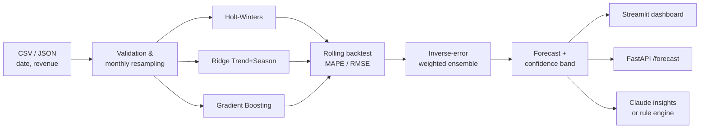

<div align="center">


# RevenueIQ

### AI-Powered Revenue Forecasting Engine

Backtested ML + statistical ensemble · confidence intervals · what-if scenarios · LLM executive insights


</div>

---

## 🎯 Why this project?

Most teams forecast revenue in spreadsheets with a single method, no seasonality handling and no idea how wrong the number might be.
**RevenueIQ** fixes that:

- 🧠 **Three different models** instead of one, blended by proven accuracy
- 🧪 **Rolling-origin backtesting** to measure real out-of-sample error (MAPE / RMSE)
- 📉 **Confidence intervals** that widen with the forecast horizon
- 🎚️ **What-if scenarios** (±30 %) for planning
- 🤖 **Executive summaries** written by an LLM (Claude), with a deterministic fallback
- 🔌 **Dashboard + REST API + Docker**, ready to deploy

---

## ✨ Features

| Area | What you get |
|---|---|
| **Forecasting** | Holt-Winters (ETS), Ridge trend + seasonality, Gradient Boosting on lag/rolling/calendar features |
| **Validation** | Rolling-origin cross-validation, per-model MAPE & RMSE, leaderboard |
| **Ensembling** | Inverse-squared-error weighting (better models earn more influence) |
| **Uncertainty** | Horizon-aware prediction bands (80 / 90 / 95 %) |
| **Dashboard** | Dark glass-style UI, KPI cards, interactive Plotly chart, CSV upload & export |
| **API** | Typed FastAPI service with validation, health check, Swagger docs |
| **Ops** | Dockerfile (non-root, healthcheck), Docker Compose, pytest suite |
| **Resilience** | A failing model never crashes the pipeline; LLM outage falls back to rule-based insights |

---

## 🏗️ Architecture



---

## 📁 Project structure

```
revenue_forecaster/
├── app.py                   # Streamlit dashboard
├── api.py                   # FastAPI REST service
├── forecasting/
│   ├── engine.py            # models, backtesting, ensemble, intervals
│   └── insights.py          # LLM + rule-based executive summary
├── tests/
│   ├── test_engine.py
│   └── test_api.py
├── .streamlit/config.toml   # theme
├── Dockerfile
├── docker-compose.yml
└── requirements.txt
```

---

## 🚀 Quick start

> **Use Python 3.10 – 3.12.** Very new versions (e.g. 3.15) lack pre-built wheels for numpy/scipy/pyyaml on Windows.

```bash
# 1. Create & activate a virtual environment
python -m venv .venv
.venv\Scripts\activate          # Windows
# source .venv/bin/activate     # macOS / Linux

# 2. Install
python -m pip install --upgrade pip
python -m pip install -r requirements.txt

# 3. Run the tests
python -m pytest -v

# 4. Launch the dashboard  ->  http://localhost:8501
python -m streamlit run app.py

# 5. Launch the API        ->  http://localhost:8000/docs
python -m uvicorn api:app --reload
```

**Optional – LLM insights:** set `ANTHROPIC_API_KEY` in your environment (never commit it).
Without it, a built-in rule engine writes the summary.

### Input data format

```csv
date,revenue
2022-01-01,250000
2022-02-01,262000
```

Minimum **24 months**. Daily/irregular rows are aggregated to monthly totals; gaps are interpolated.

---

## 🔌 API

| Method | Endpoint | Description |
|---|---|---|
| `GET` | `/health` | Liveness probe |
| `GET` | `/forecast/demo?horizon=6` | Forecast on built-in demo data |
| `POST` | `/forecast` | Forecast on your data |

**Request**

```json
{
  "data": [{"date": "2022-01-01", "revenue": 250000}, "... at least 24 rows ..."],
  "horizon": 12,
  "confidence": 0.9,
  "scenario_pct": 5,
  "include_insights": true
}
```

**Response (abridged)**

```json
{
  "points": [{"month": "2026-01-01", "forecast": 612345.0, "lower": 580100.0, "upper": 644500.0}],
  "leaderboard": [{"Model": "Holt-Winters (ETS)", "MAPE %": 2.1, "Weight": 0.48}],
  "ensemble_mape_pct": 2.4,
  "total_forecast": 7400000.0,
  "insights": "…"
}
```

Invalid input (e.g. < 24 months) returns a clear `422` error.

---

## 🐳 Docker

```bash
docker compose up --build
```

- API → http://localhost:8000/docs
- Dashboard → http://localhost:8501

Pass `ANTHROPIC_API_KEY` via your shell environment to enable LLM insights.

---

## ☁️ Deployment options

| Target | Best for | Notes |
|---|---|---|
| **Streamlit Community Cloud** | Free public dashboard | Main file `app.py`; add key under *Secrets* |
| **Render / Railway / Fly.io** | API from the Dockerfile | Bind to `$PORT`; health path `/health` |
| **AWS EC2 + Docker Compose** | Full control | Open ports 8000/8501, add Nginx + HTTPS for production |

---

## 🧠 Design decisions

- **Why an ensemble?** Different model families fail in different ways; blending lowers risk.
- **Why not deep learning / Prophet?** Monthly business data typically has only 24–60 points — simpler models generalise better and are explainable.
- **Why predict growth rate in the GBM?** Tree models can't extrapolate levels; modelling month-over-month growth makes them robust to trend.
- **Why inverse-squared-error weights?** Sharply rewards accurate models while keeping all of them in play.
- **Why a fallback for the LLM?** External services fail; the product must not.

---

## ⚠️ Limitations

- Monthly granularity only
- Univariate (no marketing spend, pricing, holidays as drivers yet)
- Confidence bands assume approximately normal errors
- API has no authentication yet

## 🗺️ Roadmap

- [ ] API-key authentication & rate limiting
- [ ] GitHub Actions CI (tests + Docker build)
- [ ] MLflow experiment tracking
- [ ] Exogenous regressors (marketing spend, promotions)
- [ ] Segment-level forecasts (product / region) with hierarchical reconciliation
- [ ] Drift monitoring and automated retraining

---

## 🧪 Testing

```bash
python -m pytest -v
```

Covers pipeline shape/ordering of intervals, accuracy sanity check, weight normalisation, input validation and API contract.

---

## 👤 Author

**Your Name** · [LinkedIn](https://linkedin.com/in/your-profile) · [GitHub](https://github.com/your-username)

<div align="center">⭐ If you found this useful, star the repo!</div>

---

## 🚀 v2 — Platform features

| Capability | Details |
|---|---|
| **6 selectable models** | Holt-Winters, Ridge, Gradient Boosting, Extra Trees, Theta, Seasonal-Naive+Drift — choose any subset in UI or API (`models`) |
| **Diagnostics** | STL decomposition, trend & seasonal strength scores |
| **Anomaly detection** | Robust MAD z-score on STL residuals, optional auto-correction before forecasting |
| **Scenario planning** | Bear / Base / Bull totals, ± what-if slider, target-gap tracking |
| **Model monitoring** | SQLite run history; old forecasts are scored against newly arrived actuals (realized MAPE) |
| **Reporting** | One-click multi-sheet Excel export |
| **API hardening** | `X-API-Key` auth, CORS, request-ID + latency logging; new `/models`, `/anomalies`, `/decompose`, `/runs` |
| **Engineering** | GitHub Actions CI (ruff + pytest + Docker build), `pyproject.toml`, `.env.example` |

Enable API auth: set `REVENUEIQ_API_KEY`, then send header `X-API-Key: <key>`.
